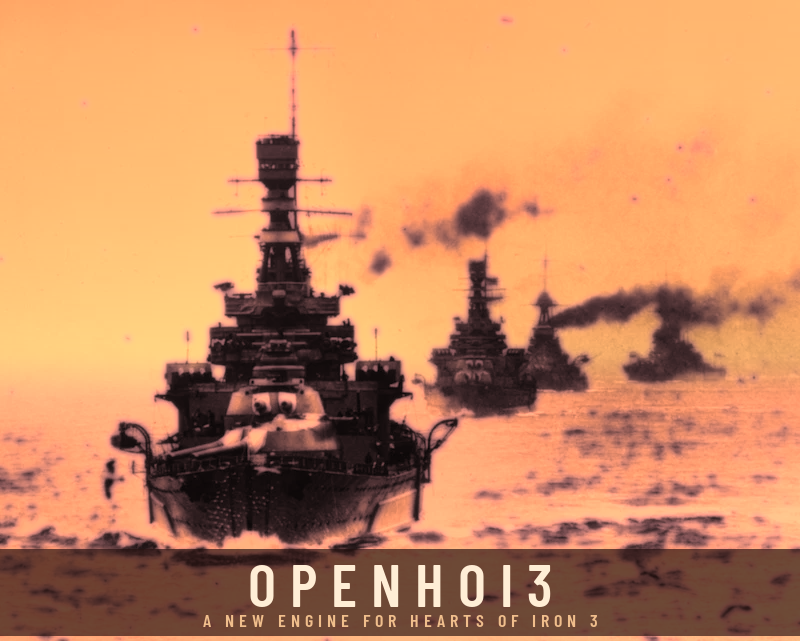

# OpenHOI3



**An open-source engine for Hearts of Iron 3: Their Finest Hour.** Point it at an install of the
game and it plays that game - its content and its mods as they are written, by the original's own
rules - on new technology: Godot 4 and C#.

OpenHOI3 is a reimplementation of what the original engine *does*, not of how its executable is
built. The rules of the simulation follow the original as closely as they can be read and checked;
the engine, the rendering and every line of code are new. You need your own copy of the game: no
game assets or data files are included here.

## Why

Hearts of Iron 3 has years of modding behind it, all written in its own language: Clausewitz
script, data files, `.gui` interface files and Lua. The largest mods rewrite nearly all of it -
BlackICE changes every one of the 33 interface files it shares with Their Finest Hour and adds 20 of
its own. A new game that asked for all of that to be redone in a new format would start with no
content and no modders. So OpenHOI3 reads an install **as it is**:

- **Script is loaded natively.** Events, decisions, triggers, effects, technologies, units, laws,
  ministers and history are read in the original's syntax with the original's keywords, so a mod's
  file is a valid file here. Where it can be stricter than the original it is: a key nothing
  recognises is reported, where the original drops it without a word.
- **The interface is built from the original's `.gui` and `.gfx` files**, laid out by our own runtime
  on a canvas that scales to any screen.
- **The AI is the install's own Lua**, run on the original's interpreter - Lua 5.1.4, built from its
  source - with the classes the original hands its scripts.
- **The map is drawn through the install's own effect files**, translated to Godot shaders as they
  load, so a mod that changes a shader changes the picture.
- **Saves are the original's `.hoi3` format**, read and written.

## Status

**In development, with no release yet.** A large part of the game is built and can be played from the
main menu: the map and its map modes, the economy, production and research, units and their
movement, land, naval and air combat, supply and convoys, leaders, events and decisions, diplomacy,
trade, war and peace, factions, politics, espionage, occupation and revolts, weather, the AI of every
country nobody plays, saving and loading, and most of the original's screens. Expect rough edges and
missing pieces.

Wherever the original can be checked, it is checked: a tool loads an install and sets what OpenHOI3
computes beside savegames the original wrote, field by field - start-date ownership, technology,
orders of battle, supply, convoys, the AI's strategies and theatres, and more. More than 3,000 unit
tests cover the parsing, the rules and the interface's text.

What is deliberately different from the original is listed in
[`docs/compatibility.md`](docs/compatibility.md). Faults of the original are kept so that it plays
the same, and listed in [`docs/enhanced.md`](docs/enhanced.md) for a planned enhanced mode.

**The base game comes first; mods second.** Laying a mod over the install works, and BlackICE starts
a new game, but playing a mod as fully as the base game is the next stage of the work.

## What you need

- **Hearts of Iron 3: Their Finest Hour**, a legitimate copy, installed.
- **Windows.** It is developed and tested there; the Lua interpreter is built with the Visual Studio
  C++ tools.
- To build it: **Godot 4.7.1 .NET** (the plain build cannot run C#), the **.NET SDK 9.x** and the
  **Visual Studio C++ build tools**. The projects target `net8.0`, which an SDK 9 builds fine.

## Building and running

```sh
dotnet build OpenHOI3.sln          # the game, the libraries and the tools
dotnet test tests/OpenHOI3.Tests   # the tests
```

**The install is found, not configured.** Put a `Hearts of Iron 3` folder holding the game beside
this repository, or a few levels above it; a folder is accepted only if the game's content is beside
the executable.

From VS Code, `F5` offers *Play OpenHOI3*, which comes up on the main menu, *Play OpenHOI3 (fast)*,
which is built optimised and the one to judge speed by, *Play OpenHOI3 (choose country)*, *Play
OpenHOI3 (mod)*, *Play OpenHOI3 (ask for arguments)*, *Play OpenHOI3 (headless)* and *Open Godot
Editor*. Set the path of the Godot executable in the `godotTools.editorPath.godot4` setting, in
`.vscode/settings.json` (git-ignored) or your user settings. The developer switches are listed above
`RunDeveloperArguments` in [`src/CSession.cs`](src/CSession.cs).

**A standalone build** is made by [`tools/export.ps1`](tools/export.ps1) into `export/OpenHOI3/`. It
needs the Godot 4.7.1 .NET export templates. An exported build plays the install it is placed in:
copy the folder's contents beside `hoi3_tfh.exe`.

**The launcher** is built by [`launcher/publish.ps1`](launcher/publish.ps1) into `export/Launcher/` -
with `-WithEngine`, the standalone build goes into its `engine` folder. Put that folder anywhere: it
finds the install, or asks for it, lists the mods to tick and starts the engine each choice is played
on, a mod's own where it ships one. [`docs/launcher.md`](docs/launcher.md) has the details.

**One typeface is downloaded rather than kept here**, because its licence does not allow it to be
published: Breitkopf Fraktur. [`fonts/readme.md`](fonts/readme.md) says where to get it; without it,
the names it is used for are drawn in Liberation Sans.

**Logs** go to `%APPDATA%\Godot\app_userdata\OpenHoi3\logs\godot.log`, with the last twenty runs
kept, and an unhandled exception is written to a `crash-<time>.log` beside it.

### Mods

A mod is laid over the install as the original lays it, found by the name of its `.mod` file:
`--mod=<name>`, or the original launcher's `-mod=mod/<file>.mod`. The savegame tool takes
`mod=<name>` too, and its `modsurvey` command lists everything a mod asks for that OpenHOI3 does not
answer yet. [`docs/mechanics/mods.md`](docs/mechanics/mods.md) has the details.

### Checking against the original

[`tools/OpenHOI3.SaveCheck`](tools/OpenHOI3.SaveCheck) loads an install and compares what the
libraries compute with savegames the original wrote:

```sh
dotnet run --project tools/OpenHOI3.SaveCheck -- "<install folder>" "<start-date savegame>.hoi3"
```

It has many more commands - the load and write of a save, the supply network, the AI's strategy, a
whole game run headless, replays and their checks. [`CLAUDE.md`](CLAUDE.md) lists each of them and
what it should report.

## How it is made

**From the original's behaviour, never from its code.** What the original computes - its formulas,
orderings, rounding, caps and tie-breaks - comes from
[hoi3-reversing](https://github.com/Dsafe1/hoi3-reversing), a separate repository of research into
the game. Each system here gets a written specification first, in
[`docs/mechanics/`](docs/mechanics/): what the original computes and how sure that is, citing the
research it came from. No address, offset or byte of the original's executable is used in this
repository.

A few rules hold throughout:

- **Fixed-point numbers.** Values are held in thousandths, as the original stores them, so that the
  simulation is deterministic and rounds the way the original does. There is no `float` or `double`
  in the game state.
- **Every change to the game state is a command.** Nothing changes the simulation directly, which is
  what lets a game be recorded and replayed and, later, shared between players.
- **The simulation has no engine in it.** The libraries under `lib/` do not reference Godot, and the
  simulation references nothing at all, so it runs headless and under test.
- **Check against a savegame.** A rule that reproduces the original's save to the thousandth is worth
  more than one that reads well.

### The interface

The original's `.gui` files give every element a pixel size, a pixel position and an *orientation* -
which corner or centre of its parent the position is measured from. So they already adapt to a
screen's shape; what they cannot adapt to is its density. OpenHOI3 adds exactly that: a pixel in a
`.gui` file is a unit on a 1920 x 1080 canvas that is scaled to the screen, and an orientation
becomes an anchor. Nothing is rewritten on disk, so a mod's interface files work unchanged.

**Element names are the contract.** A `.gui` file is layout only; what a window *does* was in the
original's executable, bound to elements by name. Each screen here finds its elements by the names
the original used, so a mod that restyles a window keeps working, and one that renames an element
breaks as it would in the original.

**Text is drawn afresh.** The original's small fonts are textures of glyphs a dozen pixels high,
which cannot be scaled into anything readable. Each font descriptor names the typeface its glyphs
were made from, and a free typeface that stands for it is drawn as outlines, at the size that makes
text as wide as the original's. Those typefaces ship in [`fonts/`](fonts/) with their licences, and
nothing is taken from the machine the game runs on. A mod can supply its own by placing a `.ttf` of
the font's name beside its descriptor. Large fonts - the names on the map, a mod's display faces -
are drawn from their own glyphs, made into distance fields as they load.

Scaling cannot add detail to a bitmap, so icons soften when enlarged. The runtime works in ratios of
a texture rather than its pixel counts so that a mod can supply a sharper file, but how a texture
says the size it was designed at is not decided yet.

## Contributing

The documents a contributor needs:

| | |
| --- | --- |
| [`docs/mechanics/`](docs/mechanics/) | one specification per system |
| [`docs/compatibility.md`](docs/compatibility.md) | where a valid file of the original's is treated differently on purpose |
| [`docs/enhanced.md`](docs/enhanced.md) | faults of the original kept as they are, and what a planned enhanced mode would change |
| [`docs/replay.md`](docs/replay.md) | recording a game and playing it back, and the state's hash |
| [`docs/layout.md`](docs/layout.md) | every folder and what it is for |
| [`docs/worklist.md`](docs/worklist.md) | the working notes: the staged plan, what is next, and what was left |
| [`CLAUDE.md`](CLAUDE.md) | the project's conventions in full, written for the AI agents that do much of the work and as true for anyone else |

The conventions in brief: every type in its own file, named after it; every file in the folder of its
subject, which is its namespace; nothing under `lib/` references Godot; a specification before each
system; and no game asset or data file is ever committed - not a texture, not a savegame, not a test
fixture taken from an install.

## Credits

OpenHOI3 was started in 2021 by [Dozed12](https://github.com/Dozed12) as a Unity project, and was
rebuilt on Godot from 2026.

- [Lua](https://www.lua.org/) 5.1.4, in [`native/lua`](native/lua), under the MIT licence
  ([`native/lua/COPYRIGHT`](native/lua/COPYRIGHT)).
- The typefaces in [`fonts/`](fonts/), each under its own licence, listed in
  [`fonts/readme.md`](fonts/readme.md).
- The icon and the picture above are made from a public-domain photograph of HMS *Repulse*
  ([`tools/icon/readme.md`](tools/icon/readme.md)).

## Licence

OpenHOI3 is free software under the **GNU General Public License, version 3** - see
[`LICENSE`](LICENSE). The third-party parts listed above keep their own licences.

OpenHOI3 is not affiliated with or endorsed by Paradox Interactive. Hearts of Iron and Their Finest
Hour are trademarks of Paradox Interactive AB. No content of the original game is distributed here;
playing OpenHOI3 needs a legitimate copy of the game.
